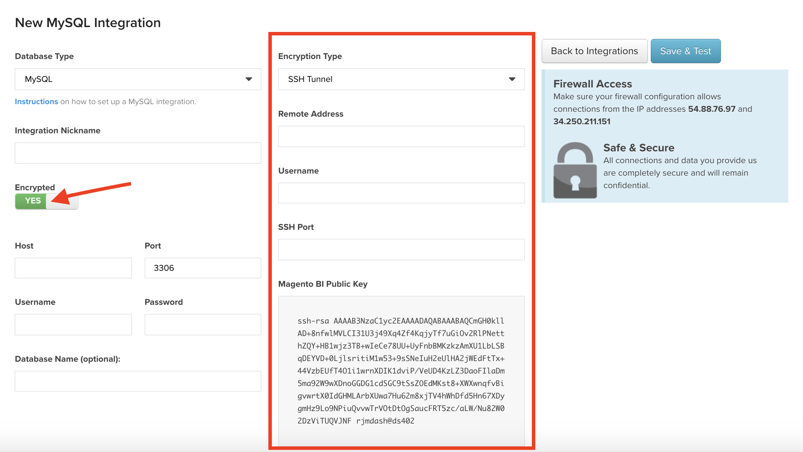

# 新增圖表至儀表板

現有圖表可使用位於畫面右上角區域的[!UICONTROL Add Report]功能新增到儀表板。 相同圖表可新增至多個儀表板，這表示如果編輯了圖表，所有含有此圖表的儀表板都會反映這項變更。

>[!NOTE]
>
>按一下&#x200B;**[!UICONTROL Add Report]**&#x200B;與按一下圖表編輯器中的&#x200B;**[!UICONTROL Save As]**&#x200B;不同。 `Add Report`僅將圖表新增到儀表板，而`Save As`會建立現有圖表的版本。

## 新增圖表

1. 按一下&#x200B;**[!UICONTROL Add Report]**。 此時會顯示現有圖表的清單。

1. 搜尋或按一下您要新增的圖表名稱。

1. 圖表會新增到儀表板。

範例：

