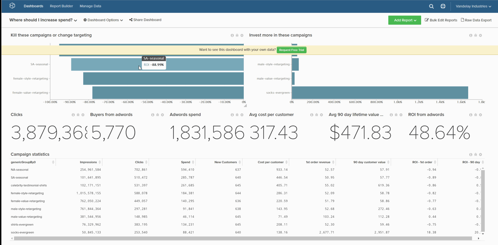

# 刪除儀表板

如果您希望儀表板清單不要變得過於雜亂，可以刪除不再需要的儀表板。 您可以透過下列兩種方式之一完成這項作業：

1. [透過`Account Settings`頁面](#account) — 此方法需要[管理員許可權](../../administrator/user-management/user-management.md)。

1. [透過`Dashboard Options`功能表](#do) — 此方法需要您擁有儀表板或擁有`Edit`許可權。

## 透過`Account Settings`頁面刪除儀表板 {#account}

1. 按一下&#x200B;**[!UICONTROL Account Settings** > **Dashboards]**。

1. 在控制面板清單中，按一下您要刪除的控制面板。

1. 按一下&#x200B;**[!UICONTROL Delete Dashboard]**。

範例：

<!--{: width="703" height="346"}-->

## 透過`Dashboard Options`功能表刪除儀表板 {#do}

1. 按一下熒幕上方的&#x200B;**[!UICONTROL Dashboard Options]**&#x200B;功能表。

1. 在下拉式清單中，按一下&#x200B;**[!UICONTROL Delete]**。

1. 提示確認時，按一下&#x200B;**[!UICONTROL Delete]**。

範例：

<!--{: width="703" height="347"}-->
